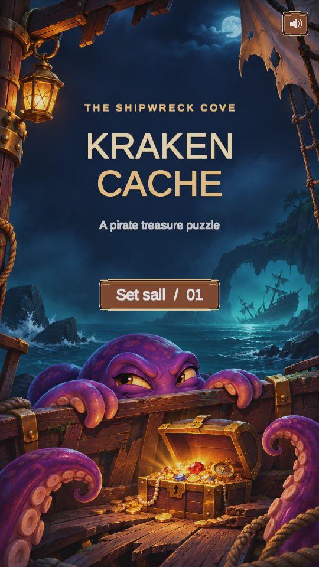
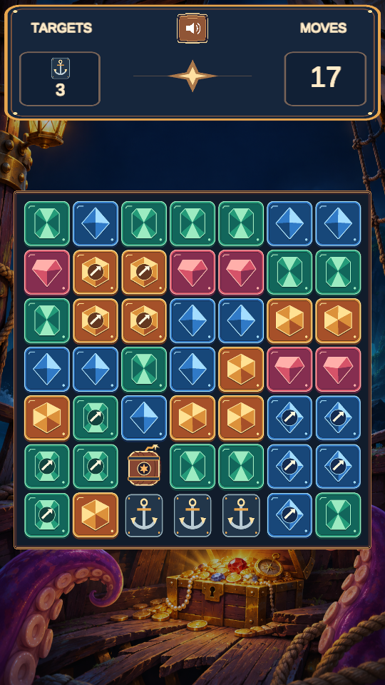

# Kraken Cache

A portrait puzzle game set in a shipwreck cove. Tap connected gems to create cannons and powder kegs. Chain blasts to clear anchors and break jugs, then open treasure chests and collect their gold.

 

## Play in Unity

1. Open the project in **Unity 6000.3.10f1**.
2. Open **MainScene** under **Assets → _Project → Scenes**.
3. Press Play. Select a **9:16** aspect ratio in Game view for the intended layout.

Groups of two or three gems clear normally. Four or five create a directional cannon, while six or more create a powder keg. Tap adjacent special pieces to combine them. The ten expeditions introduce obstacles and combinations as you progress.

## Build for the web

Install Unity's **Web Build Support** module for the editor version above. Choose **Kraken Cache → Build Web Demo** to export a static site to the project's **WebBuild** folder. Serve the folder over HTTP to try it locally. It can also be deployed to GitHub Pages.

## Credits

Project by Ahmet Meriç Kızıltaş. Pirate illustration, sprite designs and synthesized audio were produced with AI assistance. Animation uses [DOTween](https://dotween.demigiant.com/) by Daniele Giardini (Demigiant). See the included third-party notices.
